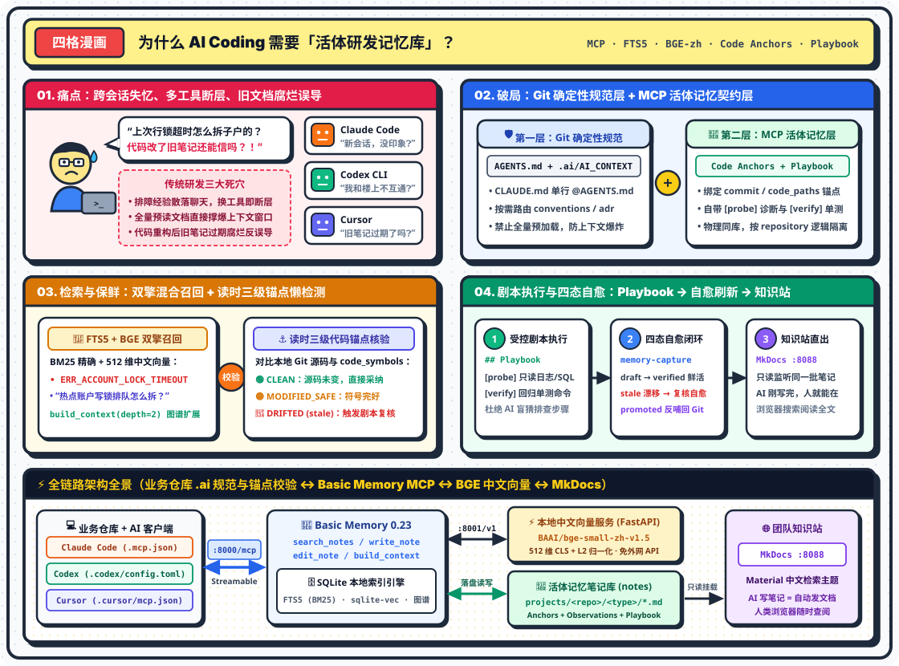

# AI Coding 研发记忆库 (MCP)


面向 **Claude Code、Codex、Cursor** 等多工具协同研发场景的本地/团队级上下文与研发经验管理服务。基于 **Git** 维护项目确定性规范（`AGENTS.md` / `CLAUDE.md` / `.ai/`），通过 **Basic Memory + MCP 协议** 沉淀历史排障经验与技术方案，结合 **SQLite FTS5 (BM25) + 本地中文 Embedding (`bge-small-zh-v1.5`)** 混合检索与 **MkDocs** 知识站，实现跨会话记忆读写与团队知识共享。



---

## 核心设计：两层知识 + 三态演进

在实际微服务研发仓库中，我们将知识分为**「Git 确定性规范」**与**「MCP 动态经验记忆」**两层，避免无脑全量加载文档撑爆上下文窗口：

### 1. 静态确定性知识（随业务 Git 仓库维护）
- **单一事实源入口**：**`AGENTS.md`** 定义模块边界、构建测试命令与代码风格；**`CLAUDE.md`** 仅一行 `@AGENTS.md` 引用同一规范，消除多工具配置漂移。
- **按需上下文路由**：**`.ai/AI_CONTEXT.md`** 约束 AI 按需读取 `docs/development/conventions.md`、`docs/architecture/`、`docs/adr/` 与 `docs/tasks/`，禁止递归预加载整个 `docs/`。

### 2. 动态经验记忆（由本服务 `:8000/mcp` 统一承载）
遵循 **`.ai/MEMORY_POLICY.md`** 规范，由三大 Skill 驱动读写闭环：
- **Git 上下文自动溯源**：读写前执行 **`.ai/scripts/get-developer-context.sh`**，自动解析当前 `repository`、`branch`、`commit` 与 `developer_id`，确保多微服务仓库笔记严格隔离。
- **三大核心 Skill（`.agents/skills/`）**：
  - **`memory-continue`**：跨会话续接或排查故障时，先按 `repository` 过滤调用 `search_notes`（`BM25 + BGE 向量`双路混合召回），再通过 `build_context(depth=2)` 沿 `[[Relations]]` 图谱拉取关联上下文。
  - **`memory-capture`**：会话中途或结束时先查重，对同一主题**原地合成覆写（Synthesize, don't append）**，杜绝碎片化流水账。
  - **`memory-notes`**：按 `projects/<repository>/<memory_type>/` 强制归档为 6 类标准笔记（`incident` 线上故障 / `debugging` 排查过程 / `solution` 解决方案 / `pitfall` 技术陷阱 / `practice` 工程实践 / `task-context` 长任务上下文）。
- **三态知识晋升闭环（`status`）**：
  **`draft`**（排查中的假设与初步证据） $\rightarrow$ **`verified`**（经测试或线上验证的确切方案） $\rightarrow$ **`promoted`**（提炼为长期团队规范沉淀回 Git 仓库的 `docs/adr/` 或 `conventions.md`）。

---

## 快速启动服务端

### 方式一：Docker Compose（推荐）

支持 Linux `x86_64` / `ARM64` 及 Apple Silicon。首次启动自动缓存约 96 MB 的 `bge-small-zh-v1.5` 权重并初始化示例笔记。

```bash
docker compose up --build --wait --wait-timeout 420
docker compose ps
```

| 服务组件 | 默认地址 | 职责说明 |
| :--- | :--- | :--- |
| **Basic Memory MCP** | `http://localhost:8000/mcp` | 供 Claude Code / Codex / Cursor 检索、读取、写入笔记 |
| **MkDocs 知识站** | `http://localhost:8088/` | 人类浏览器实时查阅同一批 Markdown 笔记 |
| **BGE 中文向量服务** | 容器内 `http://embedding:8001/v1` | 本地 CPU 推理生成 512 维 L2 归一化中文向量 |

> 端口冲突时，将 `.env.example` 复制为 `.env` 并修改 `MCP_PORT` 或 `SITE_PORT`。

### 方式二：本机直接运行（无 Docker，基于 `uv`）

```bash
uv sync --locked --managed-python --python 3.12
uv run --locked python -m coding_memory local
```

### 端到端冒烟验证

```bash
# 校验 MCP 握手与 text(错误码) / vector(中文语义) / hybrid 三路检索
python3 -m coding_memory.verify

# 额外校验 write_note -> read_note -> MkDocs 实时渲染 -> delete_note 闭环
python3 -m coding_memory.verify --write-check
```

---

## 业务仓库一键接入模板

将 `examples/client-project/` 下的文件复制到你的业务微服务仓库根目录即可完成接入：

```text
your-service-repo/
├── AGENTS.md                           # 模块结构、构建测试命令与编码规范主入口
├── CLAUDE.md                           # @AGENTS.md 单一事实源引用
├── .mcp.json                           # Claude Code MCP 接入配置 (:8000/mcp)
├── .codex/config.toml                  # Codex CLI MCP 接入配置
├── .cursor/mcp.json                    # Cursor MCP 接入配置
├── .ai/
│   ├── AI_CONTEXT.md                   # 按需加载 docs/ (conventions / adr / tasks) 路由规则
│   ├── MEMORY_POLICY.md                # 记忆检索、查重、6 大分类、脱敏与 draft->verified->promoted 晋升策略
│   └── scripts/get-developer-context.sh# 自动提取 Git repository / branch / commit / developer 元数据
└── .agents/skills/
    ├── memory-continue/SKILL.md        # 跨会话上下文恢复与关系图谱遍历
    ├── memory-capture/SKILL.md         # 会话结论查重与原地合成覆写
    └── memory-notes/SKILL.md           # Frontmatter + Observations + Relations 结构化笔记规范
```

---

## 服务端仓库结构

```text
.
├── compose.yaml                 # Docker Compose 三服务编排 (embedding / memory / site)
├── Dockerfile                   # 多阶段 uv 构建镜像
├── mkdocs.yml                   # Material for MkDocs 中文知识站配置
├── pyproject.toml               # Python 3.12 依赖分组定义 (memory / embedding / site)
├── coding_memory/
│   ├── config.py                # 核心运行时配置与目录映射 (RuntimeConfig)
│   ├── encoder.py               # FastAPI OpenAI 兼容向量服务 (BAAI/bge-small-zh-v1.5)
│   ├── __main__.py              # 服务统一入口与本机多进程编排器 (memory / embedding / site / local)
│   └── verify.py                # MCP Streamable HTTP + 混合检索 + 知识站端到端验证套件
├── examples/
│   ├── client-project/          # 业务仓库分层接入脚手架 (AGENTS.md + .ai/ + 3 Skills)
│   └── notes/                   # 示例研发记忆笔记 (troubleshooting / architecture / solution)
└── docs/
    └── assets/comic-overview.svg# 四格漫画与全链路架构图
```

## 许可证

MIT License
