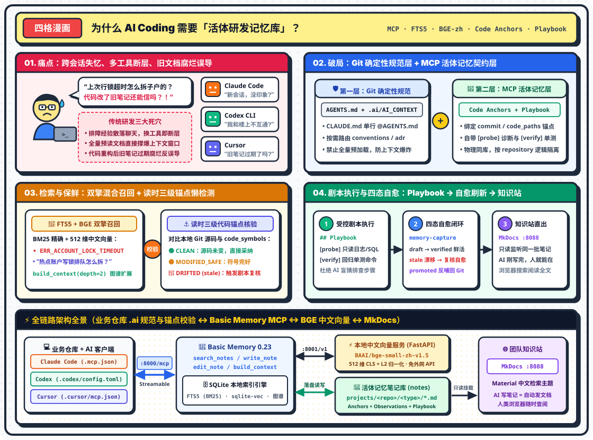
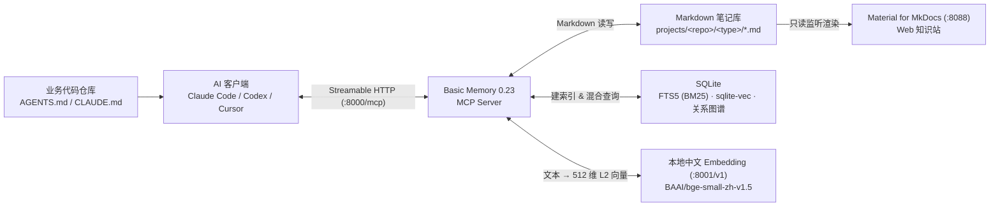

# 架构与调用机制

## 1. 数据流与调用拓扑

## 2. 检索链路（找回一条记忆）

1. **按仓库作用域过滤**：AI 客户端调用 `search_notes`，通过 `metadata_filters={"repository": "<repo>"}` 锁定当前项目范围。
2. **双路召回与融合**：
   - **关键词精确检索（`text`）**：基于 `SQLite FTS5` 与 `BM25` 匹配错误码（如 `ERR_ACCOUNT_LOCK_TIMEOUT`）、异常类名、架构编号（如 `TX_TERMINAL_PIPELINE`）。
   - **中文语义向量检索（`vector`）**：拼接查询指令前缀 `为这个句子生成表示以用于检索相关文章：`，调用本地 `bge-small-zh-v1.5` 提取 512 维 CLS 向量并做 L2 归一化（默认最低相似度阈值 `0.45`），通过 `sqlite-vec` 检索语义相近片段。
   - **混合模式（`hybrid`，默认）**：融合全文与向量两路候选结果。
3. **上下文按需组装**：AI 调用 `read_note` 读取目标 Markdown 原文，或通过 `build_context` 沿 `[[Relations]]` 双向链接拉取关联笔记。

## 3. 写入链路（沉淀一条记忆）

1. **写入前查重**：AI 先调用 `search_notes` 检查同类故障或方案是否已存在。
2. **结构化落盘**：调用 `write_note` 或 `edit_note` 将笔记写入 `projects/<repo>/<memory_type>/` 目录，包含标准 Frontmatter（`repository`、`memory_type`、`status`、`tags`）、`Observations` 与 `Relations`。
3. **索引与站点热更新**：Basic Memory 自动同步 SQLite FTS5、向量及关系索引；MkDocs 监听文件变更并实时刷新 `:8088` 页面。

## 4. 存储与运行时映射

| 存储类型 | Docker 命名卷映射 | 本机运行默认路径 (`var/`) |
| :--- | :--- | :--- |
| **Markdown 笔记文件** | `notes` $\rightarrow$ `/data/notes`（知识站只读挂载） | `var/notes` |
| **SQLite 索引与配置** | `memory-config` $\rightarrow$ `/data/config` | `var/config` |
| **HuggingFace 模型缓存** | `embedding-cache` $\rightarrow$ `/data/cache` | `var/cache/huggingface` |
